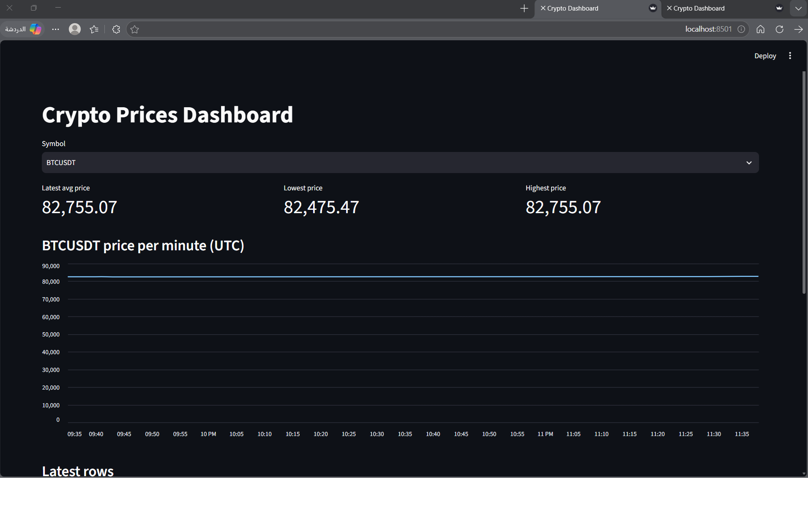
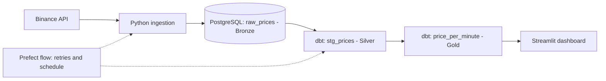

# Crypto Price Data Pipeline


An end-to-end data engineering project. It pulls live crypto prices from the Binance API, stores raw data in PostgreSQL, transforms it with dbt (Bronze → Silver → Gold), validates it with data quality tests, orchestrates it with Prefect, and serves a Streamlit dashboard.



## Architecture



| Layer | Object | Description |
|---|---|---|
| Bronze | `raw_prices` | Raw prices exactly as fetched, with a UTC timestamp |
| Silver | `stg_prices` (view) | Filtered (price > 0, symbol not null) with a per-minute bucket |
| Gold | `price_per_minute` (table) | Average, min, max price and sample count per symbol per minute |
| Gold | `dim_symbol`, `dim_time` (tables) | Dimensions: symbol and minute attributes |
| Gold | `fact_prices` (table) | Fact table: one row per symbol per minute, linked to the dimensions |

## Tech stack

| Purpose | Tool |
|---|---|
| Language | Python 3.13, SQL |
| Ingestion | `requests`, `psycopg2` |
| Storage | PostgreSQL 16 (Docker) |
| Transformation and tests | dbt-postgres |
| Orchestration | Prefect (flow, tasks, retries) |
| Dashboard | Streamlit, Altair |

## Project structure

```
crypto-pipeline/
├── dashboard/app.py          # Streamlit dashboard
├── dbt_project/              # dbt models and tests
│   └── models/{silver,gold}/
├── flows/
│   ├── pipeline.py           # Prefect flow: fetch -> load -> dbt build
│   └── serve.py              # Runs the flow every 60 seconds
├── ingestion/
│   ├── fetch_price.py        # Binance API client
│   ├── load_prices.py        # Writes prices to PostgreSQL
│   └── run_loop.py           # Simple continuous ingestion loop
├── docker-compose.yml        # PostgreSQL
├── .env.example
└── requirements.txt
```

## Getting started (Windows PowerShell)

**1. Clone and create a virtual environment**

```powershell
git clone https://github.com/Lhu-i/crypto-pipeline.git
cd crypto-pipeline
python -m venv .venv
.venv\Scripts\Activate.ps1
pip install -r requirements.txt
```

**2. Create the config files**

```powershell
Copy-Item .env.example .env
Copy-Item dbt_project\profiles.yml.example dbt_project\profiles.yml
```

**3. Start PostgreSQL** (Docker Desktop must be running)

```powershell
docker compose up -d
```

**4. Run the pipeline once** (creates the tables, loads prices, runs dbt build)

```powershell
python flows\pipeline.py
```

**5. Keep it running every 60 seconds** (optional, in a second terminal)

```powershell
python flows\serve.py
```

**6. Open the dashboard**

```powershell
streamlit run dashboard\app.py
```

Then open http://localhost:8501.

## Data quality

`dbt build` runs the models together with 10 data tests:

- `id` is unique and not null
- `symbol` is not null and one of `BTCUSDT`, `ETHUSDT`, `SOLUSDT`
- `price`, `fetched_at` and all Gold columns are not null

Because `dbt build` runs tests between layers, a failing Silver test stops the Gold model from being built. I verified this by inserting a fake symbol and confirming the test failed.

## Design decisions

- Prices are stored as `NUMERIC(20, 8)` instead of floats to avoid rounding errors.
- Timestamps are stored in UTC.
- The Prefect ingestion task retries up to 3 times if the API call fails.
- Credentials live in `.env` and `profiles.yml`, which are git-ignored.

## Known limitations

- Prefect is used as a Python library (flows, tasks, retries). The scheduling is a simple Python loop because the Prefect server and UI had a dependency conflict (FastAPI/Starlette versions) in my environment.
- This is near-real-time polling every 60 seconds, not true streaming.
- Data has gaps for periods when the pipeline was not running.

## Next steps

- [ ] Replace polling with true streaming (Redpanda/Kafka producer and consumer)
- [ ] Move orchestration to Airflow or a working Prefect server
- [ ] Add GitHub Actions to run dbt tests on every push
- [ ] Add more symbols and an incremental dbt model

## What I learned

Docker and containers, Git and GitHub workflow, the Medallion architecture, dbt models and tests, orchestration with retries, and debugging dependency conflicts.
